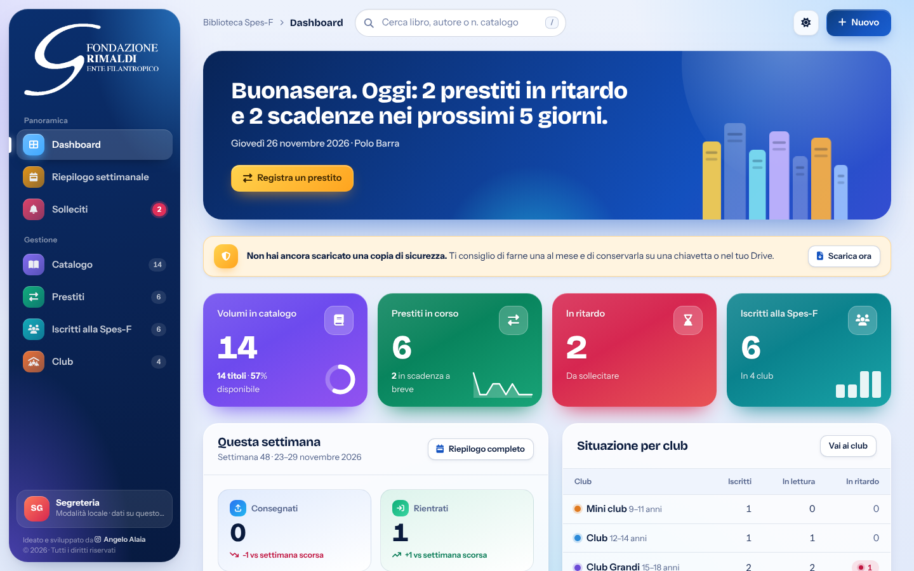
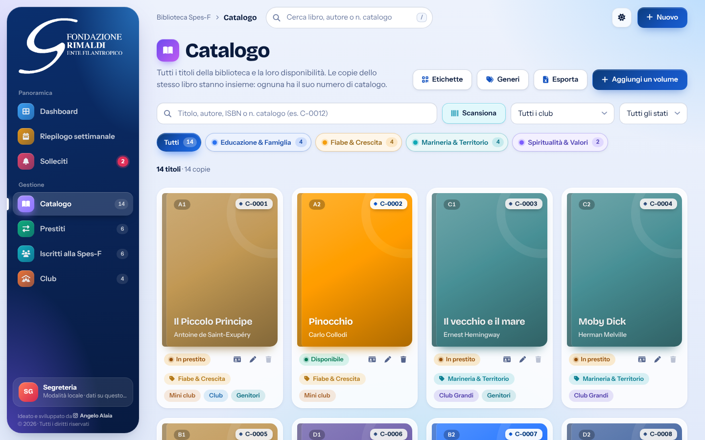
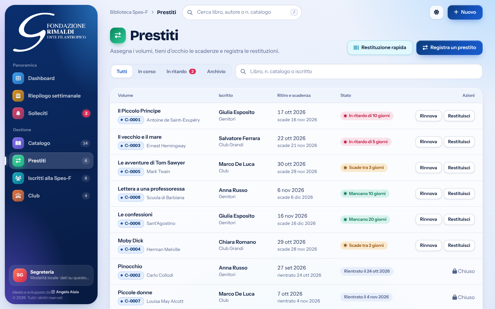
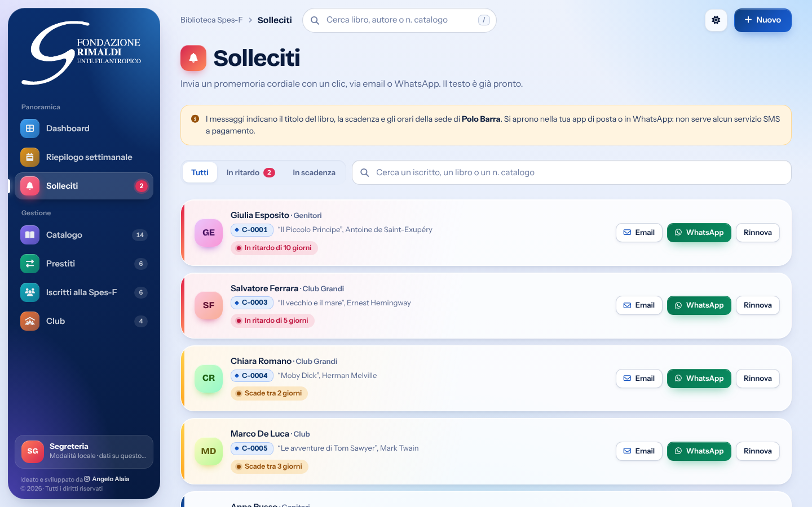
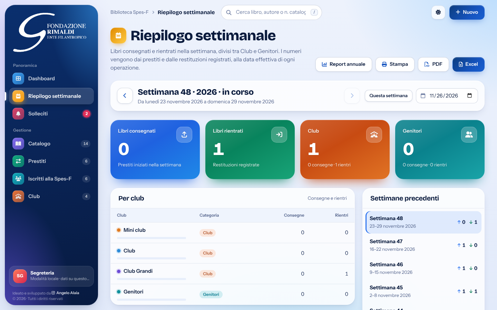
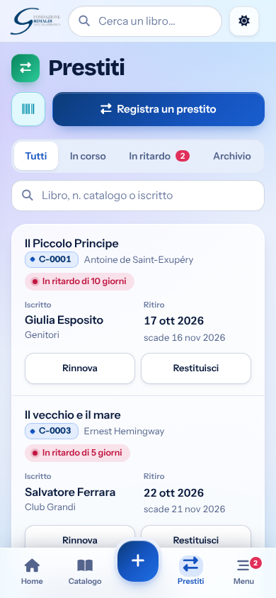

# Biblioteca Spes-F – Fondazione Grimaldi

Gestionale web per la biblioteca di comunità Spes-F della Fondazione Grimaldi (Polo Barra, Napoli). Lo usa la segreteria per tenere il catalogo dei volumi, l'anagrafica degli iscritti e i prestiti, organizzati per club di lettura in base all'età.

È un'applicazione installabile (PWA) che funziona da computer e da smartphone. I dati sono sincronizzati su Firebase e restano utilizzabili anche senza connessione.



## Funzionalità

**Catalogo**
- Volumi con numero di catalogo progressivo (`C-0001`, …), posizione a scaffale, genere e club consigliati; le copie dello stesso titolo sono raggruppate.
- Inserimento rapido scansionando il codice a barre ISBN con la fotocamera: i dati del libro vengono recuperati da SBN (Servizio Bibliotecario Nazionale), Google Books oppure Open Library.
- Suggerimento del genere a partire da soggetti e classificazione Dewey del libro.
- Stampa di etichette con QR code; il QR si può poi scansionare per trovare subito la copia.

**Iscritti e club**
- Anagrafica degli iscritti con assegnazione automatica al club in base all'età (Mini club 9–11, Club 12–14, Club Grandi 15–18, Genitori).
- Club personalizzabili per nome, fascia d'età e colore.
- Importazione di un elenco di iscritti da file JSON, con anteprima prima di aggiungere.

**Prestiti**
- Registrazione del prestito (30 giorni) e rinnovo (14 giorni), con stato calcolato: in corso, in scadenza (entro 5 giorni), in ritardo, rientrato.
- Restituzione rapida tramite scansione del QR dell'etichetta.
- Solleciti con un clic via email o WhatsApp, con il messaggio già compilato.

**Monitoraggio**
- Dashboard con prestiti in ritardo e in scadenza, situazione per club e grafici di uscite e rientri.
- Riepilogo settimanale e report annuale, esportabili in Excel (`.xlsx`) o stampabili in PDF.
- Registro delle attività e copia di sicurezza dell'archivio scaricabile e ripristinabile.

| Catalogo | Prestiti |
| --- | --- |
|  |  |

| Solleciti | Riepilogo settimanale |
| --- | --- |
|  |  |

<p align="center"></p>

*Gli screenshot mostrano i dati dimostrativi inclusi nell'app.*

## Architettura

Sito statico in HTML, CSS e JavaScript, senza framework né passaggi di build: ogni pagina corrisponde a una sezione del gestionale.

| File | Ruolo |
| --- | --- |
| `state.js` | Modello dei dati e regole (scadenze, club per età, numerazione del catalogo), persistenza in `localStorage` |
| `cloud.js` | Login e sincronizzazione con Cloud Firestore: revisioni per archivio, unione elemento per elemento in caso di modifiche concorrenti da più dispositivi, coda delle modifiche fatte offline |
| `app.js` | Layout condiviso (sidebar, barra superiore, navigazione mobile) e componenti dell'interfaccia (dialog, toast, combobox) |
| `scanner.js` | Lettura dei codici con `BarcodeDetector` o ZXing, validazione e conversione ISBN-10/13, ricerca dei dati bibliografici, generazione dei QR in SVG |
| `export.js` | Generazione di file `.xlsx` senza librerie esterne (Office Open XML in uno ZIP creato nel browser) e stampa |
| `tema.js` | Tema chiaro/scuro |
| `sw.js`, `manifest.webmanifest` | Installazione come app e funzionamento offline (network first, cache come riserva) |
| `_headers` | Intestazioni di sicurezza per Netlify (CSP, HSTS, `X-Frame-Options`, `noindex`) |

**Tecnologie:** JavaScript (ES2020+), HTML5, CSS3 · Firebase Authentication e Cloud Firestore · Chart.js · ZXing · Netlify.

Le librerie di terze parti (Firebase SDK, Chart.js, ZXing, Font Awesome) sono incluse nel repository, così il sito non dipende da CDN esterne. Versioni e licenze sono indicate in `COPYRIGHT.txt`.

## Avvio in locale

Basta un qualsiasi server statico:

```bash
python3 -m http.server 8080
```

e aprire `http://localhost:8080`. Lasciando vuoto `apiKey` in `firebase-config.js`, l'app lavora in modalità locale (dati salvati solo nel browser); i dati dimostrativi si caricano dal menu di ripristino.

## Configurazione online

1. Creare un progetto Firebase con Authentication (email e password) e Cloud Firestore.
2. Inserire in `firebase-config.js` i parametri del progetto e, in `emailAutorizzata`, le impronte SHA-256 degli account abilitati.
3. Limitare l'accesso con le regole di Firestore. Il controllo nel browser serve all'interfaccia; la protezione dei dati è affidata alle regole:
   ```
   rules_version = '2';
   service cloud.firestore {
     match /databases/{database}/documents {
       match /biblioteca/{doc} {
         allow read, write: if request.auth != null
           && request.auth.token.email in ['account1@example.com', 'account2@example.com'];
       }
     }
   }
   ```
4. Facoltativo: indicare in `sbnProxy` l'indirizzo di un Cloudflare Worker che inoltra le richieste al catalogo SBN, che non accetta chiamate dirette dal browser. Il codice del worker non è incluso in questo repository.
5. Pubblicare la cartella su Netlify (o su un altro hosting statico).

## Licenza

© 2026 Angelo Alaia. Tutti i diritti riservati: vedi [`COPYRIGHT.txt`](COPYRIGHT.txt). Il nome e il logo della Fondazione Grimaldi appartengono ai rispettivi titolari.
